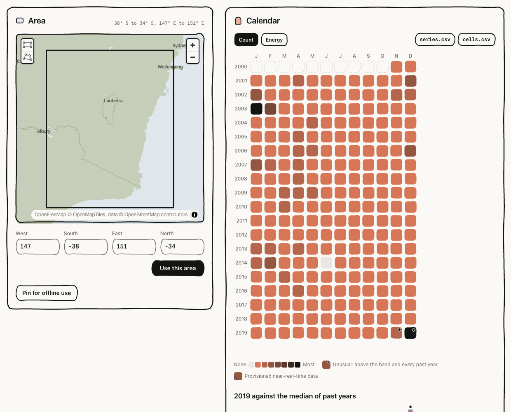

# firecal

A burning-activity calendar for any area you pick, from NASA's MODIS and VIIRS fire hotspots made to agree, with
how sure every number is. NASA Space Apps 2026.

**Open it: https://firecal.pages.dev/** (the app is at [/app/](https://firecal.pages.dev/app/); the 30-second film is
on the site and in the [space-apps-2026 release](https://github.com/looprotate/firecal/releases/tag/space-apps-2026)).



Draw an area on the map, or type its bounds, and see every month since 2000: months across, years down, in hotspot
counts or fire radiative power. A month is flagged unusual only when it rises past its uncertainty and above every
past year; the past years most like this one are listed; the numbers download as CSV; and a pinned region keeps
answering with no network. The hosted app has data for all of Australia, November 2000 to December 2019; the map
outlines it, and an area outside it says so.

The data is NASA FIRMS: MODIS Collection 6.1 and VIIRS 375 m active-fire hotspots, with VIIRS mapped onto MODIS
per tile. A hotspot is a thermal anomaly seen from orbit, not a fire or a burned area.

## How it works

One Rust core harmonizes the archive into static tiles and, compiled to WebAssembly, answers every question in the
browser, byte for byte the same as the native build. There is no server: the app is a static site that works
offline. The interface, the site and the film share one hand-drawn style.

## Run it

```
cargo xtask build-wasm
npm --prefix web ci
npm --prefix web run dev
```

Then open http://localhost:5173. For data, put the files of the
[tiles-australia-2019 release](https://github.com/looprotate/firecal/releases/tag/tiles-australia-2019) (all but
`SHA256SUMS.txt`) in `web/public/tiles/`; without them the calendar shows a hand-made sample and says so. The site
is `site/`, plain files.

Apache-2.0.
